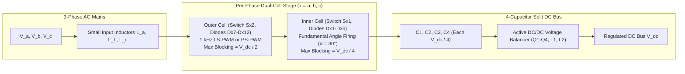

# ⚡ Five-Level Multiple-Pole VIENNA Rectifier (5L-MVR): Applied Design & Modulation Playbook

> **Primary Reference**: G. Ooi H. P., A. I. Maswood, Z. Lim, and M. A. Chaitanya, *"Input Current Shaping of Five-Level Multiple-Pole VIENNA Rectifier Topologies with Reduced Component and Better Performance,"* IEEE, pp. 900–905, 2013.

---

## 1. Engineering Problem & When to Use 5L-MVR

In medium-to-high-power AC-DC front-end drives (e.g., industrial motor drives, telecom rectifiers, EV fast-charger front-ends), conventional 3-level VIENNA or NPC rectifiers require high PWM switching frequencies ($10\text{--}20\text{ kHz}$) to keep input line inductor ($L_{a,b,c}$) volume and input current $\text{THD}_i$ low. That high switching frequency creates severe $dv/dt$ stress, EMI filtering overhead, and switching losses.

The **5L-MVR** solves this by synthesizing a **5-level stepped input voltage** ($+V_{dc}/2, +V_{dc}/4, 0, -V_{dc}/4, -V_{dc}/2$) using **only 6 active switches total** (2 per phase: one **Inner Cell** switch $S_{x1}$ and one **Outer Cell** switch $S_{x2}$), operating at **1 kHz** outer-cell PWM combined with fundamental-frequency inner-cell angle firing ($\alpha = 30^\circ$).

---

## 2. Governing Equations for Hardware Sizing

### 2.1 Five-Level Pole Voltage & Modulation Index
With a 4-capacitor split DC link ($E = V_{dc}/4$ per capacitor):
$$v_{xN} \in \left\{ +2E,\; +E,\; 0,\; -E,\; -2E \right\} = \left\{ +\frac{V_{dc}}{2},\; +\frac{V_{dc}}{4},\; 0,\; -\frac{V_{dc}}{4},\; -\frac{V_{dc}}{2} \right\}$$

The AC-to-DC modulation index $M$ relates peak phase voltage $\hat{V}_x$ to total DC bus voltage $V_{dc}$:
$$M = \frac{2\,\hat{V}_x}{V_{dc}}, \qquad 0.5 < M \le 1.0$$

### 2.2 Optimal Firing Angle ($\alpha$) Selection
- **Inner Cell ($S_{x1}$)**: Conducts from $\alpha$ to $\pi - \alpha$ in each half-cycle, triggered by a grid zero-crossing PLL.
- **Outer Cell ($S_{x2}$)**: Modulated at $1\text{ kHz}$ using either **Level-Shifted PWM (LS-PWM)** or **Phase-Shifted PWM (PS-PWM)**.
- **Design Sweet Spot** *(verify in the Live Simulator above)*:
  - **LS-PWM**: $\alpha_{\text{opt}} = 30^\circ$ yields $\text{PF} \approx 0.999$ and minimum $\text{THD}_i = 3.43\%$.
  - **PS-PWM**: $\alpha_{\text{opt}} = 25^\circ$ yields $\text{PF} \approx 0.999$ and minimum $\text{THD}_i = 3.60\%$.

### 2.3 Capacitor Voltage Balancing & Power-Balance Loop
The outer-loop PI controller regulates total $V_{dc}$ by scaling the sinusoidal current reference $i_{x,\text{ref}} = I_{\text{peak}}\sin(\omega t - \phi_x)$ in phase with $v_x$, while the auxiliary buck-boost balancing stage ($Q_1\text{--}Q_4, L_1, L_2$) equalizes $V_{C1}=V_{C2}=V_{C3}=V_{C4}=V_{dc}/4$.

---

## 3. Applied Engineering Design & Commissioning Checklist

| Step | Engineering Action | Target / Verification Metric |
| :--- | :--- | :--- |
| **1. Switch Voltage Rating** | Select $S_{x1}$ (Inner) for $\ge 1.5\times (V_{dc}/4)$ and $S_{x2}$ (Outer) for $\ge 1.5\times (V_{dc}/2)$ | Inner switches need half the blocking rating of outer switches |
| **2. Zero-Crossing PLL** | Implement clean hardware/digital ZCD with hysteresis for $\alpha$ timer | Phase jitter $< 0.2^\circ$ to prevent even-harmonic injection |
| **3. Modulation Mode** | Choose **LS-PWM** with $\alpha = 30^\circ$ for lowest THD; use **PS-PWM** with $\alpha = 25^\circ$ if thermal sharing between outer devices is prioritized | Confirm $\text{THD}_i < 5\%$ (IEEE 519 compliance) at $f_{\text{sw}} = 1\text{ kHz}$ |
| **4. DC-Link Balancer** | Verify $C_1\text{--}C_4$ imbalance $< 2\%$ under step load changes | Prevents asymmetric stepped levels ($+E$ vs $-E$) |
| **5. Dead-Time & Snubbers** | Because VIENNA cells are unidirectional, shoot-through is structurally impossible; only diode reverse-recovery $di/dt$ snubbing is needed | Inspect $v_{CE}$ overshoot at turn-off |
