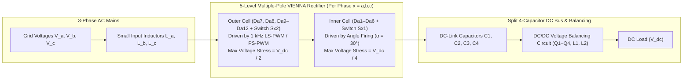

# ⚡ Input Current Shaping of Five-Level Multiple-Pole VIENNA Rectifier Topologies with Reduced Component and Better Performance

> **Authors**: Ooi H. P. Gabriel, Ali I. Maswood, Lim Ziyou, and M. Abhinava Chaitanya (*School of Electrical and Electronic Engineering, Nanyang Technological University, Singapore*)
> **Publication**: IEEE (978-1-4799-0224-8/13), pp. 900–905, 2013
> **Source PDF**: [Input_current_shaping_of_five_level_Multiple_pole_VIENNA_rectifier.pdf](Reading/Input_current_shaping_of_five_level_Multiple_pole_VIENNA_rectifier.pdf)

---

## 1. Executive Summary & Architectural Motivation

Multilevel active front-end (AFE) rectifiers—such as the conventional three-level **VIENNA rectifier** and **Neutral-Point-Clamped (NPC) rectifier**—are widely deployed in industrial drives to regulate DC-link voltage while maintaining low input current Total Harmonic Distortion ($\text{THD}_i$) and near-unity Power Factor ($\text{PF}$). However, conventional three-level topologies face a fundamental trade-off:
1. **High Switching Frequency Penalty**: Minimizing input inductor ($L_a, L_b, L_c$) volume and input current ripple requires very high PWM switching frequencies, which severely increases electromagnetic interference (EMI), $dv/dt$ stress, and semiconductor switching losses.
2. **Limitations of Prior Low-Loss Schemes**:
   - **(a) Low Conduction Period Control**: Reduces device switching stress but requires bulky input line reactors at narrow conduction angles.
   - **(b) Resonant DC-Link Circuits** & **(c) Transformer-Assisted ZVS PWM**: Achieve Zero-Voltage Switching (ZVS) / Zero-Current Switching (ZCS), but add substantial control complexity, auxiliary components, and converter weight.

### Key Innovation of the Proposed 5L-MVR Topology
This paper introduces a **Unidirectional Three-Phase Five-Level Multiple-Pole VIENNA Rectifier (5L-MVR)** requiring **only 6 active IGBT switches total** (two switches per phase: one in the **Inner Cell** $S_{x1}$ and one in the **Outer Cell** $S_{x2}$):
- Synthesizes a **5-level stepped input voltage waveform** ($+V_{dc}/2, +V_{dc}/4, 0, -V_{dc}/4, -V_{dc}/2$), drastically reducing $dv/dt$ and input inductor size.
- Employs a **Hybrid Modulation Strategy**:
  - **Inner Cell Switches ($S_{a1}, S_{b1}, S_{c1}$)**: Operated at fundamental grid frequency using a **Fixed Switching Angle Firing Method ($\alpha = 30^\circ$)** triggered at grid voltage zero-crossings.
  - **Outer Cell Switches ($S_{a2}, S_{b2}, S_{c2}$)**: Operated using **low-frequency (1 kHz) Carrier-Based PWM** (Level-Shifted PWM **LS-PWM** or Phase-Shifted PWM **PS-PWM**).
- **Validated Performance**: Achieves **$\text{PF} = 0.99$** and **$\text{THD}_i = 3.43\%$** at a low **1 kHz** switching frequency with a compact, low-cost power-balance control loop.

---

## 2. Topology Hierarchy & Bidirectional Switch Configurations

The 5L-MVR is derived from a bidirectional multiple-pole multilevel diode-clamped hierarchy (Fig. 3), simplified for unidirectional power flow with two cascaded VIENNA cells per phase:
- **Outer Cell**: Clamps the phase node to the outer DC rails ($+2E = +V_{dc}/2$ and $-2E = -V_{dc}/2$) via fast recovery diodes $D_{x7}, D_{x8}$ and bidirectional switch $S_{x2}$.
- **Inner Cell**: Clamps the intermediate voltage levels ($+E = +V_{dc}/4$, $0$, and $-E = -V_{dc}/4$) via diodes $D_{x1}\text{--}D_{x6}$ and bidirectional switch $S_{x1}$.

| Cell Stage | Active Switch | Clamping Diodes | Modulation Scheme | Switching Frequency | Voltage Stress |
| :--- | :--- | :--- | :--- | :--- | :--- |
| **Inner Cell** | $S_{a1}, S_{b1}, S_{c1}$ | $D_{x1}\text{--}D_{x6}$ | Fixed Switching Angle Firing ($\alpha = 30^\circ$) | Grid Zero-Crossing (Fundamental) | **$V_{dc} / 4$** |
| **Outer Cell** | $S_{a2}, S_{b2}, S_{c2}$ | $D_{x7}\text{--}D_{x12}$ | Carrier-Based PWM (LS-PWM or PS-PWM) | **1 kHz** (Low Switching Loss) | **$V_{dc} / 2$** |

---

## 3. Hybrid Switching Schemes & Analytical Device Stress Equations

As illustrated in **Fig. 4**, the inner cell switches ($S_{a1}, S_{b1}, S_{c1}$) begin conducting at each zero-crossing point of the grid phase voltage with a fixed conduction angle $\alpha = 30^\circ$, while the outer cell switches ($S_{a2}, S_{b2}, S_{c2}$) are modulated by 1 kHz PWM throughout the $30^\circ\text{--}150^\circ$ window.

### Complete Analytical Equations (Eq. 1–5)

1. **Maximum Current Through Inner Cell Switch ($S_{x1}$)** during the first conduction period ($\omega t = 0^\circ\text{ to }30^\circ$):
$$i_{(sw1)\max} = \frac{\sqrt{2}V_i}{\omega L \sqrt{3}}\left(\frac{2 - \sqrt{3}}{2} + \frac{M\pi}{24\sqrt{2}}\right) \qquad \text{(1)}$$

2. **Voltage Transfer Ratio ($M$)** regulating the DC-link voltage $V_{dc}$ relative to RMS line-to-line grid voltage $V_i$:
$$M = \frac{V_{dc}}{\sqrt{3}V_i} \qquad \text{(2)}$$

3. **Maximum Current Through Outer Cell Switch ($S_{x2}$)** under unity power factor during $\omega t = 60^\circ\text{ to }90^\circ$:
$$i_{(sw2)\max} = \frac{\sqrt{2}V_i}{\omega L \sqrt{3}}\left(1 - \frac{M\pi}{8\sqrt{2}}\right) \qquad \text{(3)}$$

4. **Maximum Current Through Inner Cell Diode ($D_{x1}$)** at $\omega t = 90^\circ$ (when $S_{a1}$ is off, $i_{(d1)\max}$ equals $i_{(sw2)\max}$):
$$i_{(d1)\max} = i_{(sw2)\max} = \frac{\sqrt{2}V_i}{\omega L \sqrt{3}}\left(1 - \frac{M\pi}{8\sqrt{2}}\right) \qquad \text{(4)}$$

5. **Maximum Current Through Outer Cell Diode ($D_{x7}$)** when both switches ($S_{x1}$ and $S_{x2}$) are turned off:
$$i_{(d7)\max} = \frac{\sqrt{2}V_i}{\omega L \sqrt{3}}\left(1 - \frac{5M\pi}{24\sqrt{2}}\right) \qquad \text{(5)}$$

---

## 4. Power Balance Controller & DC-Link Regulation (Eq. 6–9)

The closed-loop controller (**Fig. 5**) combines an outer **DC-Link Voltage Control Loop** (PI compensator) with an inner **Power-Balance Dynamic Current Control Loop**.

### Power-Balance Reference Current Formulation

6. **Instantaneous Phase Reference Current $i_a^*(t)$** (sum of Load Current Estimator component + Equivalent Capacitor Current component):
$$i_a^*(t) = \left[i_{\text{load}}(t) + i_{C_{eq}}(t)\right]\sin(\omega t) = \left[\frac{\sum_{x \in \{a,b,c\}} \left[V_{xo}(t) - L_x\frac{di_x(t)}{dt} - R_x i_x(t)\right] i_x(t)}{V_{dc}(t)} + C_{eq}\frac{dV_{dc}(t)}{dt}\right]\sin(\omega t) \qquad \text{(6)}$$

7. **Grid Voltage Peak Amplitude Detector ($V_{\text{peak}}$)** (valid under both balanced and unbalanced grid conditions):
$$V_{\text{peak}} = \left[\left(\frac{2}{3}V_{ao}(t) - \frac{1}{3}V_{bo}(t) - \frac{1}{3}V_{co}(t)\right)^2 + \left(\frac{1}{\sqrt{3}}V_{bo}(t) - \frac{1}{\sqrt{3}}V_{co}(t)\right)^2\right]^{1/2} \qquad \text{(7)}$$

8. **Supply Voltage Unit Sinusoidal Template**:
$$\sin(\omega t) = \frac{V_a(t)}{V_{\text{peak}}} \qquad \text{(8)}$$

9. **Open-Loop Transfer Function of Energy Storage DC-Link Model**:
$$L(s) = K_p\left(1 + \frac{1}{T_i s}\right) \times \frac{3V_m}{V_{dc}C_{eq}} \times \frac{1}{s + 6V_m / (V_{dc}C_{eq}R)} \qquad \text{(9)}$$
where $K_p$ is selected via pole cancellation for stable DC bus regulation. Two 1 kHz triangular carrier waves are compared against the current error and combined through a logic **NAND gate** to drive $S_{x2}$.

---

## 5. Simulation Results: LS-PWM vs. PS-PWM, Waveforms & THD Analysis

### Switching Angle Optimization ($\alpha = 0^\circ\text{ to }50^\circ$, Fig. 6 & Fig. 7)
- **Power Factor (Fig. 6)**: Exceeds **$0.99$** for all inner-cell switching angles $\alpha > 10^\circ$.
- **Input Current THD (Fig. 7)**: Reaches its minimum band between $\alpha = 20^\circ\text{ and }30^\circ$.
  - **Optimal LS-PWM Point**: $\alpha = 30^\circ \implies \text{THD}_i = \mathbf{3.43\%}$, $\text{PF} = \mathbf{0.99}$.
  - **Optimal PS-PWM Point**: $\alpha = 25^\circ \implies \text{THD}_i = \mathbf{3.60\%}$, $\text{PF} = \mathbf{0.99}$.

### Ripple Reduction & Harmonic Performance (Eq. 10–11, Fig. 8–10)

10. **Input Current Ripple Approximation** over switching interval $D T_s$:
$$\Delta i_a(t) = \int_0^{DT_s} \frac{V_{ao}(t) - V_{am}(t) - V_{mo}(t)}{L_a}\,dt \qquad \text{(10)}$$

11. **Power Factor & THD Relationship**:
$$\text{PF} = \frac{\cos\varphi_1}{\sqrt{1 + \text{THD}_i^2}} \quad \text{(reported in paper Eq. 11 as } \frac{\cos\varphi_1}{\sqrt{1 - (\text{THD}_i)^2}} \text{)} \qquad \text{(11)}$$

