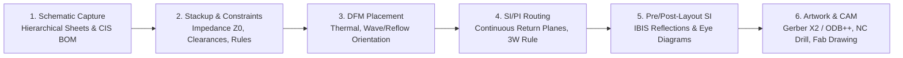

# 🖥️ High-Speed PCB Layout, Stackup & Signal Integrity: Applied Engineering Playbook

> **Primary Reference**: K. Mitzner, B. Doe, A. Akulin, A. Suponin, and D. Müller, *"Complete PCB Design Using OrCAD Capture and PCB Editor (2nd Edition),"* Newnes / Elsevier, 2019.

---

## 1. End-to-End Schematic-to-Fabrication Engineering Flow

---

## 2. Controlled Impedance & Transmission-Line Equations

### 2.1 Critical Trace Length ($l_{\text{crit}}$)
A PCB trace behaves as a distributed transmission line (requiring impedance control and termination) whenever its physical length $l$ exceeds half the rising-edge spatial length:
$$t_{pd} \approx 85\sqrt{\varepsilon_{\text{eff}}}\;\text{ps/in} \quad\left(3.34\sqrt{\varepsilon_{\text{eff}}}\;\text{ps/mm}\right), \qquad l_{\text{crit}} = \frac{t_r}{2\,t_{pd}}$$
- **Rule of Thumb**: For a $1\text{ ns}$ rise time on FR-4 ($\varepsilon_{\text{eff}} \approx 3.2$, $t_{pd} \approx 152\text{ ps/in}$), $l_{\text{crit}} \approx 3.3\text{ in}$ ($84\text{ mm}$). Fast CMOS/LVDS ($t_r = 0.3\text{ ns}$) drops $l_{\text{crit}}$ to $\sim 1.0\text{ in}$ ($25\text{ mm}$).

### 2.2 Surface Microstrip & Symmetric Stripline $Z_0$
- **Surface Microstrip** (outer layer over reference plane at height $h$, trace width $w$, copper thickness $t$):
$$Z_{0,\text{microstrip}} = \frac{87}{\sqrt{\varepsilon_r + 1.41}}\ln\left(\frac{5.98\,h}{0.8\,w + t}\right)\;\Omega$$
- **Symmetric Stripline** (inner layer centered between two reference planes separated by $b = 2h + t$):
$$Z_{0,\text{stripline}} = \frac{60}{\sqrt{\varepsilon_r}}\ln\left(\frac{4\,b}{0.67\,\pi\,(0.8\,w + t)}\right)\;\Omega$$

### 2.3 Reflection Coefficient & Termination Strategy
$$\Gamma_L = \frac{Z_L - Z_0}{Z_L + Z_0}, \qquad \Gamma_S = \frac{Z_S - Z_0}{Z_S + Z_0}$$
- **Series Source Termination**: Add $R_S = Z_0 - R_{\text{driver}}$ right at the driver pin (ideal for point-to-point CMOS clocks).
- **Parallel Load Termination**: Place $R_T = Z_0$ at the receiver (for multi-drop buses or differential LVDS/CML pairs).

---

## 3. Return Current, Crosstalk ($3W$) & Padstack DFM Rules

| Engineering Domain | Design Rule | Failure Prevented |
| :--- | :--- | :--- |
| **Return Current Path** | Never route high-speed signals across a split-plane gap; stitch ground vias adjacent to layer-transition signal vias | Dipole EMI radiation & inductive ground bounce ($L\,di/dt$) |
| **Crosstalk ($3W$ Rule)** | Center-to-center spacing $S \ge 3W$ (edge-to-edge $\ge 2W$) for parallel aggressor/victim traces | Near-end ($K_b$) & far-end crosstalk false triggering |
| **Decoupling ESL** | Keep power/ground via-pair loop tiny ($< 1.5\text{ mm}$); use lowest-ESL package (0402/0201) close to IC pins | High-$f_{\text{SRF}}$ impedance spikes on PDN |
| **Annular Ring Padstack** | Size pad $D_{\text{pad}} \ge D_{\text{drill}} + 2\cdot AR_{\min} + T_{\text{fab}}$ ($T_{\text{fab}} \approx 8\text{--}12\text{ mil}$) | Drill breakout & open inner-layer connections |
| **Thermal Reliefs** | Use 4-spoke thermal reliefs on through-hole ground/power pins (unless high-current $>5\text{ A}$ requires direct flood) | Cold solder joints during wave/reflow soldering |
