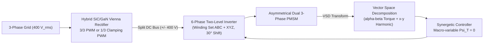

# ⚙️ Vienna Rectifier Front-End Dual Three-Phase PMSM Drive: Applied Control Playbook

> **Primary Reference**: S. Ohno, M. Haider, and S. Mirić, *"Vienna Rectifier Front-End Dual Three-Phase PMSM Drive with Synergetic Control,"* IEEE ICRERA, 2025.

---

## 1. System Architecture & Engineering Motivation

Industrial high-power drives increasingly pair a **3-phase Vienna Rectifier (VR)** active front-end with an **asymmetrical dual three-phase PMSM** ($30^\circ$ phase shift between winding sets $ABC$ and $XYZ$, isolated neutrals). This architecture reduces DC-link capacitance, splits phase current across six inverter legs, and provides fault tolerance.

---

## 2. Front-End Modulation Trade-Off: 3/3 PWM vs. 1/3 Six-Step Clamping

In the live simulator above, switch between **Mode 1 (3/3 PWM)** and **Mode 2/3 (1/3 PWM)** to observe how discontinuous clamping reduces switching loss:

1. **3/3 Continuous PWM (Mode 1)**:
   - All three phases switch continuously over the full $360^\circ$ grid cycle.
   - Lowest current ripple, but highest semiconductor switching loss.
2. **1/3 Six-Step Clamping PWM (Modes 2 & 3)**:
   - In each $60^\circ$ sector, the phase carrying the **largest absolute current** is clamped directly to the $+V_{dc}/2$ or $-V_{dc}/2$ rail (zero switching transitions for $1/3$ of the fundamental period).
   - **Result**: Switching losses drop by **$\sim 33\%$** while maintaining $\text{PF} > 0.99$ and low $\text{THD}_i$, at the expense of a slight increase in mid-point capacitor ripple.

---

## 3. Dual 3-Phase PMSM Vector Space Decomposition (VSD) & Synergetic Control

### 3.1 VSD Subspaces
Using the $6\times 6$ Clarke-style VSD transformation, the 6 stator currents map into three orthogonal planes:
- **$\alpha\text{-}\beta$ (Fundamental Torque Plane)**: Maps into rotating $d\text{-}q$ frame for flux ($i_d = 0$ MTPA) and electromagnetic torque ($T_e \propto i_q$).
- **$x\text{-}y$ (Harmonic Loss Plane)**: Carries $5\text{th}, 7\text{th}, 17\text{th}, 19\text{th}$ harmonics that produce **zero torque** and pure copper loss—must be actively regulated to $i_x^* = i_y^* = 0$.
- **$z_1\text{-}z_2$ (Zero-Sequence)**: Blocked when neutrals $N_1, N_2$ are isolated.

### 3.2 Nonlinear Synergetic Control Law vs. Linear PI
Standard decoupled PI current loops suffer from phase lag and cross-coupling ($\omega_e L_q i_q$, $\omega_e L_d i_d$) at high electrical frequencies (e.g., $300\text{ Hz}$). Synergetic control defines a macro-variable manifold $\Psi_T = i_q^* - i_q$ and enforces exponential convergence:
$$T\,\dot{\Psi}_T + \Psi_T = 0 \implies v_q = R_s i_q + \omega_e(L_d i_d + \lambda_m) + L_q\left(\dot{i}_q^* + \frac{i_q^* - i_q}{T}\right)$$
where **$T$** is the designer-chosen convergence time constant:
- **Smaller $T$**: Faster step rise time and near-zero tracking phase error at $300\text{ Hz}$ sinusoidal torque commands, but higher transient $v_q$ control effort.
- **Larger $T$**: Smoother voltage demand, slower step settling.

---

## 4. Practical Commissioning Guide

1. **Neutral Isolation**: Keep the two 3-phase star neutrals ($N_1, N_2$) isolated so $z_1\text{-}z_2$ circulating currents are eliminated by hardware.
2. **Dead-Time Compensation**: Because the $x\text{-}y$ plane impedance is purely $R_s + s L_{ls}$ (very small inductance), inverter dead-time distortion easily excites large $i_x, i_y$ currents; always include dead-time compensation and active $x\text{-}y$ current regulation.
3. **Tuning $T$**: Start with $T \approx 2\text{--}3\times T_s$ (sampling periods) and decrease $T$ until inverter DC-bus voltage saturation is approached during worst-case torque steps.
