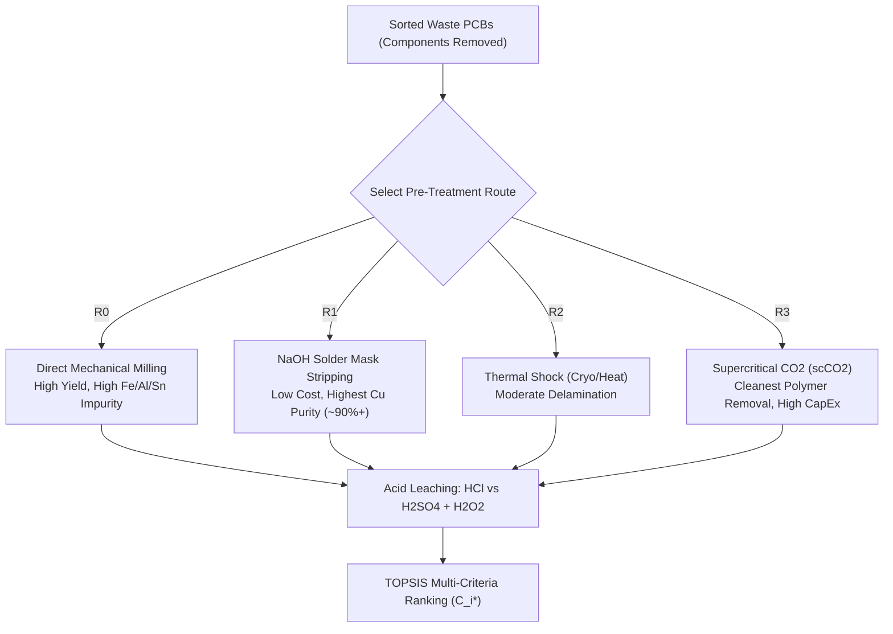

# ♻️ Hydrometallurgical Copper Recovery from Waste PCBs: Pre-Treatment & TOPSIS Optimization Playbook

> **Primary Reference**: M. Gómez, A. Barnadas-Rodríguez, C. Domínguez, L. Asensio, and J. L. Valiente, *"From e-waste to resource: Identifying the optimal pre-treatment for copper recovery from waste PCBs,"* *Resources, Conservation & Recycling*, vol. 228, 108821, 2026.

---

## 1. Engineering Context: Why Pre-Treatment Governs Leaching Economics

Waste Printed Circuit Boards (WPCBs) contain $15\text{--}30\text{ wt\%}$ copper alongside solder ($\text{Sn/Pb}$), steel/aluminum hardware ($\text{Fe/Al}$), and epoxy solder-mask polymers. Direct acid leaching of un-pretreated PCBs wastes reagents on base-metal impurities and suffers from mass-transfer blockage by the polymer solder mask.

---

## 2. Analytical Framework & TOPSIS Equations

### 2.1 Mass Loss & Leaching Recovery Metrics
$$\text{Mass Loss (\%)} = \frac{m_{\text{initial}} - m_{\text{final}}}{m_{\text{initial}}} \times 100, \qquad \eta_{\text{Cu}}(t) = \frac{C_{\text{Cu}}(t)\,V_{\text{leach}}}{m_{\text{Cu,total}}} \times 100\%$$

### 2.2 TOPSIS Multi-Criteria Decision Analysis (MCDA)
To balance competing plant KPIs—**Copper Purity ($C_1$)**, **Copper Yield ($C_2$)**, **Leaching Time ($C_3$)**, **Operating Cost ($C_4$)**, and **Environmental Impact ($C_5$)**—TOPSIS normalizes the decision matrix $r_{ij}$, applies weights $w_j$ ($\sum w_j = 1$), and computes Euclidean distances to the Positive Ideal ($A^+$) and Negative Ideal ($A^-$) solutions:
$$v_{ij} = w_j \frac{x_{ij}}{\sqrt{\sum_{i=1}^m x_{ij}^2}}, \qquad D_i^+ = \sqrt{\sum_j (v_{ij} - v_j^+)^2}, \qquad D_i^- = \sqrt{\sum_j (v_{ij} - v_j^-)^2}$$
$$C_i^* = \frac{D_i^-}{D_i^+ + D_i^-}, \qquad 0 \le C_i^* \le 1$$
Higher **$C_i^*$** indicates the best overall engineering compromise.

---

## 3. Acid System & Process Selection Matrix

| Process Parameter | $\text{HCl}$ Leaching System | $\text{H}_2\text{SO}_4 + \text{H}_2\text{O}_2$ System | Engineering Recommendation |
| :--- | :--- | :--- | :--- |
| **Base-Metal Co-Dissolution** | Dissolves $\text{Sn, Pb, Fe, Al, Zn}$ rapidly | Selective toward $\text{Cu}$ when $\text{H}_2\text{O}_2$ oxidant is controlled | Use $\text{H}_2\text{SO}_4\text{-H}_2\text{O}_2$ for downstream electrowinning purity |
| **$\text{H}_2\text{O}_2$ Decomposition** | N/A | Catalyzed by $\text{Fe}^{3+}$ and heat; requires staged dosing | Dose $\text{H}_2\text{O}_2$ incrementally at $30\text{--}45^\circ\text{C}$ |
| **Best Pre-Treatment** | **NaOH Stripping** removes solder mask without $\text{Fe/Al}$ pulverization | **NaOH Stripping** achieves $>90\%$ leachate Cu purity | Use the **TOPSIS Weight Sliders** above to test your plant's cost vs. purity priorities |
