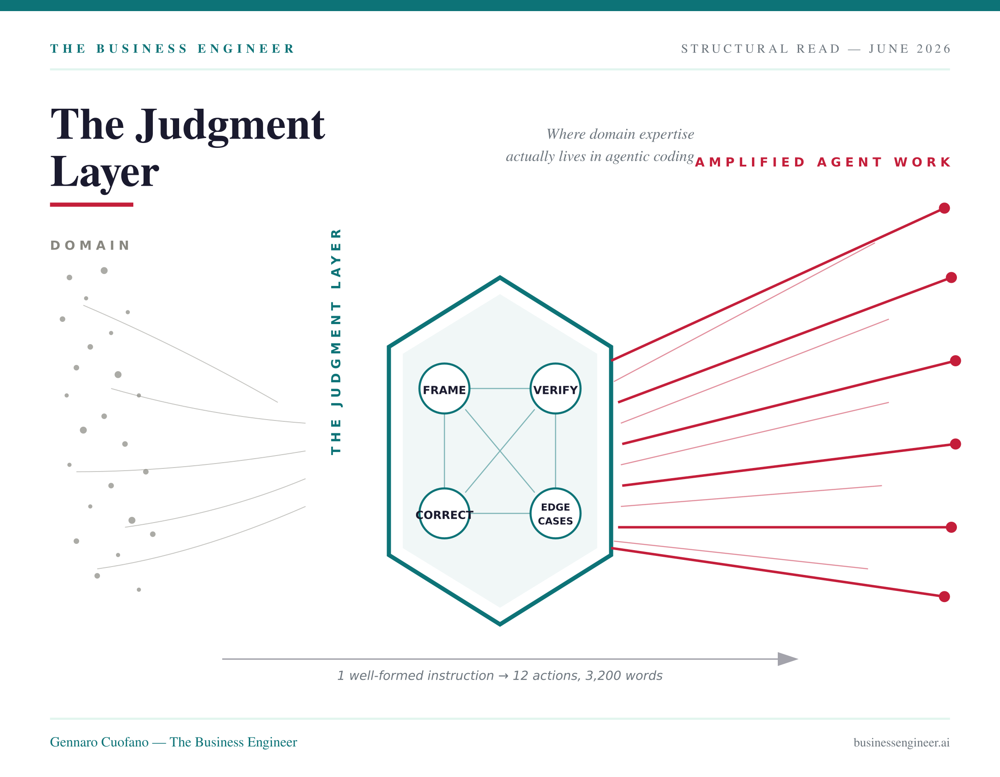
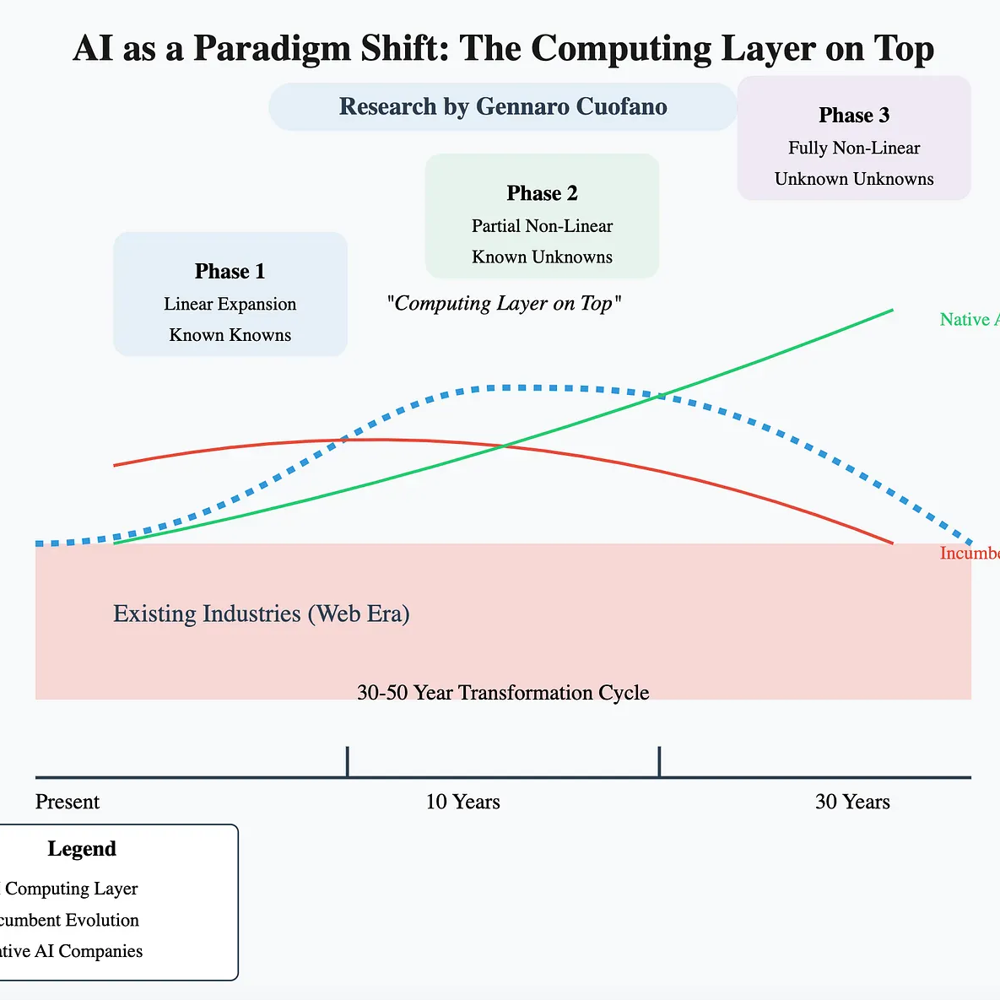
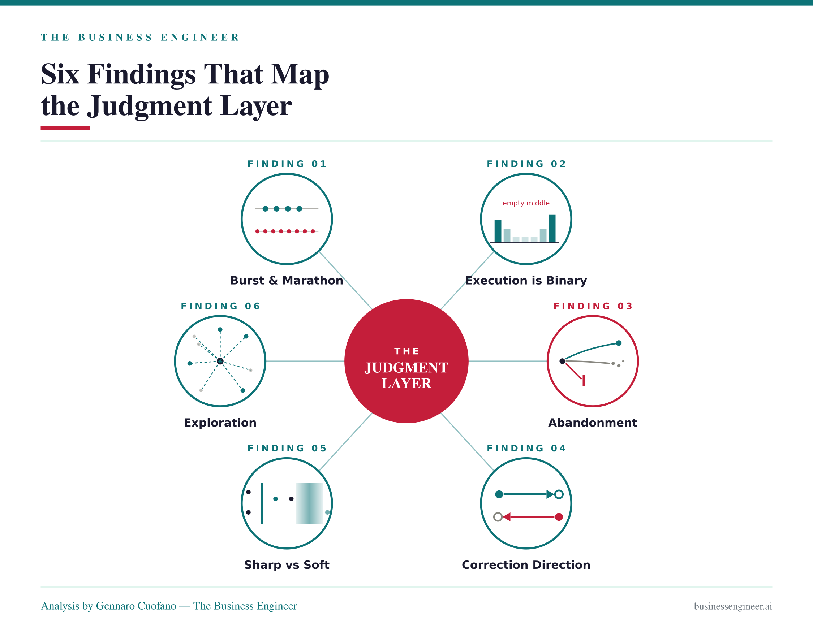
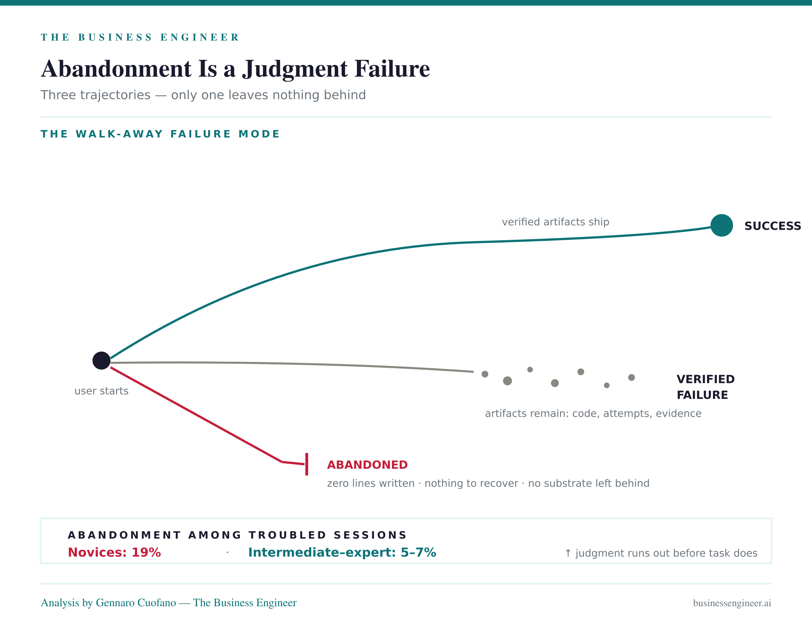
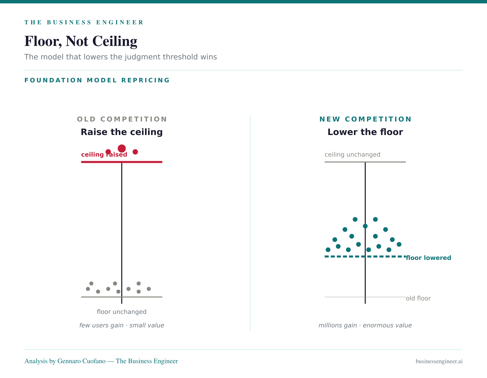

# The State of Agentic Work

**Author:** Gennaro Cuofano  
**Published:** Jun 17, 2026  
**Source:** [The Business Engineer](https://businessengineer.ai/p/the-state-of-agentic-work)

---

**[We are living through an AI supercycle.](https://businessengineer.ai/p/the-ai-supercycle)**

What makes this moment unique is that it is often misunderstood as a story about automation. In reality, it is increasingly a story about augmentation.

The emerging model is not AI replacing humans. It is humans equipped with AI, and increasingly with fleets of AI agents, becoming capable of orchestrating work that previously required teams of people. The leverage comes not from AI alone, but from the combination of human judgment and machine execution.

This is what it means to "live in the harness."

> **My Life in the Harness** — Gennaro Cuofano · Jun 13  
> *I don't work in a chat window anymore. I work in the Business Engineer's harness.*

The core skill is no longer performing every task directly. Instead, it is developing the judgment, systems thinking, and architectural capability required to design, coordinate, and continuously refine networks of AI agents. As these architectures improve, a single individual can operate across more domains, tackle more complex problems, and manage a broader range of activities than was previously possible.

My argument is that over the next 12 months we will move from a world where individuals manage dozens of AI agents to one where they can effectively direct hundreds.

However, this does not diminish the importance of the human layer. Quite the opposite.

The quality of agent output remains highly dependent on the judgment layer sitting above it. AI agents can execute, analyze, synthesize, and act, but their effectiveness is constrained by the quality of the goals, constraints, feedback loops, and strategic direction provided by the human operator.

**The bottleneck is shifting from execution capacity to judgment capacity.**

As AI becomes abundant, the scarce resource is not intelligence, but the ability to direct intelligence toward meaningful real-world outcomes. The individuals who can design effective agent architectures, allocate resources, establish feedback systems, and continuously refine objectives will generate disproportionate leverage.

In that sense, the future is not defined by how many agents you have access to. It is defined by how effectively you can govern them.

Anthropic just released the June 2026 Economic Index, which gives us the first large-scale empirical map of agentic coding — four hundred thousand interactive Claude Code sessions, 235,000 users, seven months of telemetry. The headline finding, that domain expertise matters more than coding skill, has been widely covered. The deeper story has not. What the data actually reveals is the operational shape of the Judgment Layer — the irreducible human contribution that sits between domain knowledge and agent execution, and that the agent itself cannot replicate.

The Judgment Layer is the single most under-discussed concept in agentic AI. It is what domain experts have that novices don't. It is what creates the 5x amplification gap the report measures. And it is the layer the entire AI stack is now structurally repricing around, even though most stack participants have not yet realized that's what they're doing.

---

## What the Judgment Layer Actually Is

Domain expertise is usually discussed as if it were a soft attribute — "knowing your field." In operational terms inside an agentic workflow, it is something much more specific. It is the set of cognitive functions that the human performs that the agent structurally cannot:

- **Framing** — translating a real-world problem into a specification the agent can act on, with the right scope, the right constraints, and the right acceptance criteria
- **Verifying** — recognizing whether the agent's output is correct, useful, and safe to deploy, against domain ground truth the agent doesn't have access to
- **Correcting** — identifying specific errors in the agent's work and redirecting it precisely, rather than asking for a generic retry
- **Recognizing edge cases** — anticipating where the agent will fail before it fails, and steering around the failure mode

These four functions are what the report's expertise classifier is actually measuring, even though it doesn't use this language. The novice can't frame precisely, can't verify reliably, can't correct surgically, and can't anticipate failure. The expert can do all four. The intermediate can do enough of them to capture most of the gain.

The Judgment Layer is not a metaphor. It is the operational location where domain knowledge gets converted into agent productivity. Everything in the report — the action multipliers, the success differentials, the abandonment rates, the recovery patterns — is a measurement of judgment density. The questions worth asking now are: where does judgment cluster, where does it fail, and what scaffolds it?

---

## Six Findings That Map the Judgment Layer

### 1. The Two Modes Have Different Judgment Profiles

The median session has four user turns. But expert sessions in the report's classifier table show prompt counts of 88, 106, 108. And the footnote on action chains is striking: 2% of sessions average more than 100 actions per prompt, 1 in 270 average more than 200, 1 in 2,300 average more than 500.

This bimodality is a Judgment Layer story. Burst sessions are short because the judgment required is light — frame once, accept the output, ship it. Marathon sessions are long because the judgment is dense — frame, verify, correct, reframe, repeat, often across hundreds of micro-decisions. The marathon user isn't more verbose. They are exercising judgment at a higher rate per minute.

This means the agentic-coding market will bifurcate into burst products and marathon products, priced and engineered differently. Burst products optimize for latency and low judgment overhead. Marathon products optimize for sustained throughput and judgment-density support — context retention, verification scaffolding, structured review surfaces. One product cannot serve both well at sustainable margins.

### 2. Execution Delegation Is a Binary, Not a Gradient

The decision-attribution data shows planning roughly unimodal (most users plan most of the time) but execution sharply bimodal: about half of all sessions have Claude making 90–100% of execution decisions, with another spike at the bottom where users keep tight control. The middle is empty.

The Judgment Layer reading is clean. Users either hand execution to the agent and concentrate their judgment at the review step, or they keep execution and distribute their judgment across each step. They don't mix the two. Co-execution — the idealized "human and agent working side by side" — barely exists in the data.

This has direct product implications:

- Harnesses built around cooperative step-by-step handoff are solving a problem that doesn't exist. The empirical user wants either "do this for me" or "help me as I drive." The middle ground is empty.
- The review step is where judgment lands when execution is delegated. Compressing review time — through better diffs, structured summaries, verification scaffolding — produces more value than improving collaboration time.
- The most valuable product surface in a harness is the review surface, not the prompt surface.

### 3. Abandonment Is a Judgment Failure, Not a Capability Failure

Among sessions that hit trouble:

- **Novices:** 40% verified failure, 19% abandonment
- **Experts:** 18% verified failure, 7% abandonment

Note the ratio. Roughly half of novice failures end in abandonment — the user walks away with zero lines of code written. Roughly two-fifths of expert failures do.

Abandonment is the failure mode where judgment runs out before the task does. The novice can't diagnose what went wrong, can't formulate a recovery, and can't decide whether to retry or abandon. They walk away. The expert, even when they fail, leaves artifacts — wrong code, partial attempts, evidence of structured attempts to recover. Their judgment kept producing direction even when execution failed.

This is the single largest unaddressed product opportunity in current harness designs. The 19% novice abandonment rate is not a model-capability problem. It is a judgment-scaffolding problem. Defaults that nudge toward retry, automatic decomposition into smaller steps, structured "you seem stuck, try this" affordances — these interventions cost almost nothing to build and target the exact users for whom the harness currently underperforms.

### 4. Direction of Correction Is the Single Cleanest Signal of Judgment Quality

The expertise classifier looks for three signals. The third is the most important and the most under-discussed: whether the user tends to correct Claude, or Claude tends to correct the user.

This is the cleanest behavioral marker of judgment quality available. When the user catches the agent's errors before the agent catches its own, the user holds epistemic authority. When the agent flags issues the user missed, the agent holds it. The direction of correction reveals who is actually judging the work.

The strategic implication: the most valuable users to a harness are not the heaviest users. They are the users who correct the agent most precisely. Their corrections are the highest-quality training signal available — domain experts catching real model errors in production context, with ground-truth justification.

Harnesses that capture and learn from expert correction patterns are building a moat invisible to outsiders. The substrate becomes self-reinforcing: experts correct, corrections train the harness to support intermediates better, intermediates produce better output with less correction needed, the harness pulls more users up the curve. Harnesses that don't capture corrections are leaving the most valuable training signal on the floor.

### 5. The Communicate Anomaly Is a Judgment-Threshold Signal

Estimated task value rose across categories between October 2025 and April 2026:

- **Building tasks:** +43%
- **Operating tasks:** +34%
- **Fixing tasks:** +32%
- **Communicate (writing, documents):** +2%

Three categories grew by roughly a third. One barely moved. The report notes this without explaining it.

The explanation is judgment-threshold. Building tasks have sharp acceptance criteria — the code compiles, the test passes, the system runs. Verification requires judgment, but verification is possible. Communicate tasks have soft acceptance criteria — the document reads well enough, the slide is good enough. The judgment required to distinguish "acceptable" from "excellent" is much harder to formalize.

When judgment thresholds are sharp, the human's role stays valuable because verification stays necessary. When judgment thresholds are soft, the agent's output is increasingly accepted without verification, and the price of the work collapses toward the cost of inference.

This is the leading indicator for what happens in other knowledge-work verticals. Categories with sharp acceptance thresholds hold their value. Categories with soft thresholds collapse in price. Writing is the first vertical to feel it. Legal contracts, financial models, medical documentation, engineering specs — these have sharp thresholds and will hold value longer. Marketing copy, general summaries, presentations — these have soft thresholds and will commoditize faster than people expect.

### 6. The 7.7% Unclassifiable Is Judgment Being Built

Nearly one in thirteen sessions has no clear goal. The report excludes them from its main analysis. They are more important than that exclusion suggests.

Sessions without clear goals are sessions where the user is exploring, probing, building intuition. This is judgment in formation — users learning what the harness can do, where it fails, how to frame, how to verify. This is how every new harness gets adopted: users explore, find what works, and then deploy on real tasks.

Harnesses that suppress exploration through pricing, latency, or friction starve the on-ramp. Harnesses that reward exploration convert it into long-term marathon usage. The 7.7% is the visible signature of the next cohort of expert users being made.

---

## The Cascade — Why the Judgment Layer Reshapes the Stack

Once you see the Judgment Layer clearly, the cascade through the Map of AI sharpens.

Every layer of the stack interfaces with the Judgment Layer in some way, and the strategic question for each layer is: how does this layer scaffold, scale, or substitute for judgment?

### The Foundation Model Layer Reprices Around Floor Reduction

The dominant framing for foundation-model competition has been "make the model smarter." The Judgment Layer reading reframes the competition. The valuable model is not the one that performs best for experts. It is the one that lowers the judgment threshold required to reach intermediate performance.

The novice-to-intermediate gap is where most of the amplification gain lives. A model that converts a million novices into intermediates is worth orders of magnitude more than one that converts a hundred thousand experts into deeper experts, because the intermediate band is where most users are. This is why Sonnet-class models are winning despite Opus being more capable. It is why model differentiation has shifted from benchmark ceilings to behavior under ambiguous instructions. The floor matters more than the ceiling, because the floor is where new judgment gets onboarded.

### The Harness Layer Captures the Amplification

The agentic harness is the only layer where judgment density gets converted into agent output. It is where framing happens, where verification happens, where correction happens. Every layer beneath it scales against the harness's gain coefficient, which is set by the judgment quality flowing through it.

This makes the harness the structurally dominant layer in the agentic stack. Whoever builds the harness that best scaffolds judgment — through context, taxonomies, verification surfaces, correction capture — owns the multiplier. Everything else in the stack is downstream of that decision.

### The Substrate Becomes the Strategic Asset

The thread running through every finding is that judgment quality depends on what the human can bring to bear. The expert with a rich domain model judges precisely. The novice without one judges generically. The structured substrate of a domain — its taxonomies, ontologies, decision rules, knowledge graphs — is what lets a non-expert judge at expert level.

This is the structurally hard-to-replace asset of the agentic era. Models are increasingly fungible at the frontier. Harnesses are increasingly replicable. The substrate is what encodes the cumulative domain work of the people who built it, and it cannot be replicated without that work.

The pattern that played out in software — where structured codebases, package ecosystems, and type systems amplify agent capability — will play out in every other vertical. Legal will be amplified by structured case law and contract ontologies. Finance by structured filings and entity graphs. Healthcare by structured clinical pathways. Commerce by product catalogs with real entity-level relationships.

Whoever owns the substrate owns the amplification. That is the strategic prize the report makes visible without naming.

### The Infrastructure Layers Reprice Against the Wrong Load Curve

The lower layers of the stack — compute, silicon, foundries, energy — have been planning capacity against a load curve that assumes static user productivity. The report reveals that this curve is wrong in three ways.

First, expert amplification means each active user drives more inference load per session than naive forecasts assume, and the user base is shifting expert-ward over time.

Second, the marathon-mode session is structurally distinct from the burst-mode session, with sustained inference profiles that favor high-bandwidth memory over raw compute throughput. The HBM bottleneck tightens as the user base shifts toward marathons.

Third, the non-interactive workload the report explicitly excludes is probably an order of magnitude larger by total compute than the interactive workload it measures. Headless agents running in pipelines, automated review systems, scheduled batch processing — these are sustained marathon-mode loads at scale, invisible in the published data but present in the actual infrastructure demand.

The combined effect: every layer with a long repricing clock is being undersized. Energy buildouts planned in 2024 against 2024 load curves will be undersized when 2027 demand arrives. Foundry capacity committed today against today's forecasts will lag the actual workload. The chronic undersizing of AI infrastructure projections has a structural cause — forecasters were modeling against the wrong load curve, and the right one has only just been published.

---

## The Compression

The Anthropic report is usually read as commentary on the future of coding work. The deeper read is structural and economic.

The Judgment Layer is the new scarce resource. It is the irreducible human contribution that agents cannot replicate. It is where domain expertise lives operationally. It is what creates the amplification the report measures, and what every layer of the stack is now being repriced around — whether the participants in those layers have realized it yet or not.

**Three claims compress the whole picture:**

1. **Domain experts are judgment specialists.** Their economic value in the agentic era comes not from execution skill but from framing, verifying, correcting, and recognizing edge cases — the four functions agents structurally cannot perform.

2. **The substrate is the strategic asset.** Structured domain knowledge — taxonomies, ontologies, knowledge graphs, decision rules — is what scaffolds judgment for non-experts and lets them perform at expert level. Whoever owns the substrate captures the amplification.

3. **The infrastructure stack is mispriced.** Every layer from compute to energy has been planning against the wrong load curve. The repricing is already underway in the model and harness layers. It is coming to the deeper layers over the next eighteen months to four years, depending on each layer's repricing clock.

**The single sentence:**

> Agentic AI has not eliminated the human contribution. It has concentrated it in the Judgment Layer — and the strategic prize of the next decade goes to whoever builds the substrate that scales judgment from the few who have it to the many who need it.

That is the state of agentic coding, read through the only frame that explains all the numbers at once.

---

## Key Takeaways & Mental Models

Five frameworks organize the structural read of the Anthropic data, and together they explain every finding in the report.

**The Judgment Layer** is the operational location of domain expertise — the cognitive functions of framing, verifying, correcting, and recognizing edge cases that agents structurally cannot perform. It is what creates the 5x amplification gap between expert and novice sessions, and it is what every other layer of the stack is now repricing around.

**Cognitive Range** explains why the expertise gradient is non-linear. The novice-to-intermediate gap is wide because reaching intermediate requires a working domain model — a baseline mental architecture that frames problems and recognizes wrong answers. The intermediate-to-expert gap is narrow because once the domain model exists, marginal expertise adds little additional capacity to judge precisely. Competence is the threshold; mastery is decoration.

**Harness Theory** explains the planning/execution split. The user owns the Planner and the Surface; the agent owns the Loop and most of the Memory mechanics. The 70/80 division in the report is the empirical signature of this division of labor across the harness's four sub-systems — the first quantitative measurement of how human-agent labor actually divides when both parties are competent at what they do.

**The Substrate as Moat** explains the strategic prize. Structured domain knowledge — taxonomies, ontologies, knowledge graphs, decision rules — is what scaffolds judgment for non-experts and lets them perform at expert level. Whoever owns the substrate captures the amplification, regardless of which model or harness sits on top of it. The model is fungible. The harness is replicable. The substrate is what encodes the cumulative domain work of the people who built it, and it cannot be replicated without redoing that work.

**Constraint Cascade** explains why the infrastructure stack is mispriced. The compute, silicon, foundry, and energy layers have been planning capacity against a load curve that assumes static user productivity. The actual curve is steeper, because the user base is shifting expert-ward and each expert extracts more agentic work per session over time. Every layer with a long repricing clock is being structurally undersized — and the lower the layer in the stack, the longer it takes to reprice.

---

### The Four Takeaways

1. **The Judgment Layer is the new scarce resource.** Agents have not eliminated the human contribution. They have concentrated it in framing, verifying, correcting, and recognizing edge cases. These four functions are the irreducible human work of the agentic era.

2. **Substrate ownership decides who captures the value.** In every vertical the agentic harness enters next — legal, finance, healthcare, commerce, operations — the actor that owns the structured domain substrate is positioned to capture the amplification. The capture question is open in every market that has not yet been mapped.

3. **The market will bifurcate, not converge.** Burst products and marathon products, sharp-threshold tasks and soft-threshold tasks, expert harnesses and novice harnesses, interactive workloads and headless workloads — the optimal designs for each are too different to share a product. The agentic-coding market is the first to feel this bifurcation; every other agentic market will follow.

4. **Every layer of the stack is repricing — most participants have not realized it yet.** The chronic undersizing of AI infrastructure projections has a structural cause that the report's data now makes visible. The repricing is already underway in the model and harness layers. It is coming to compute, silicon, foundries, and energy over the next eighteen months to four years, on each layer's own clock.

---

**The single sentence that holds everything together:**

> Agentic AI is a redistribution of leverage from execution skill to judgment density — and the strategic prize of the agentic era goes to whoever builds the substrate that scales judgment from the few who have it to the many who need it.
